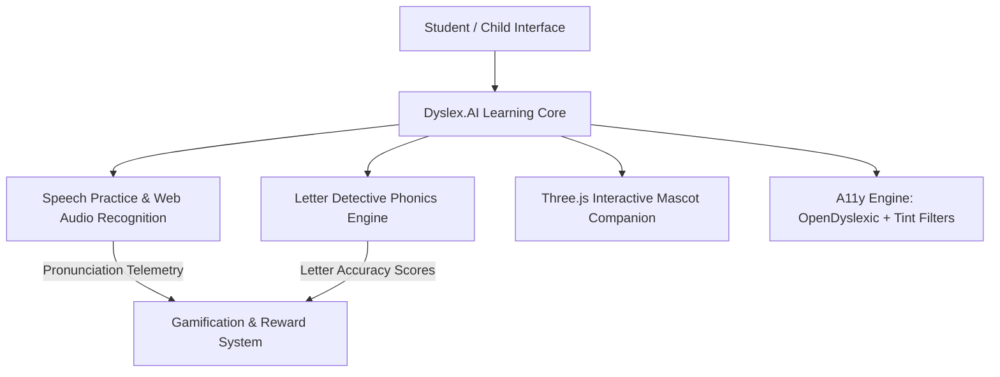

# Dyslex.AI — Cognitive Learning & Assistive Reading Suite

[](https://react.dev/)
[](https://www.typescriptlang.org/)
[](https://vitejs.dev/)
[](https://tailwindcss.com/)
[](https://threejs.org/)
[](https://www.w3.org/WAI/standards-guidelines/wcag/)

An assistive, gamified cognitive learning interface engineered for children and students with dyslexia. Designed from the ground up with cognitive ergonomics, neurodivergent-friendly typography, speech recognition, and 3D interactive learning companions.

---

## Interactive Learning Experience & Companion

<p align="center">
  
</p>

---

## Technical Highlights & Cognitive Features

1. **Neurodivergent-First Typography & Visual Calming**:
   - Integrated **OpenDyslexic** dynamic web fonts featuring weighted bottom baselines to prevent letter flipping and optical rotation.
   - Tinted color overlays (Peach, Mint, Rose, Lavender, Cream) based on Irlen Syndrome research to alleviate visual stress and contrast glare.
2. **Interactive Phonics & "Letter Detective"**:
   - Visual discrimination drills specifically targeting mirrored letter confusion (e.g., `b` vs `d`, `p` vs `q`, `m` vs `w`).
3. **Speech Practice & Phonic Articulation**:
   - Web Speech API integration providing instant pronunciation feedback, phoneme reinforcement, and auditory guidance.
4. **Interactive 3D Companion (`Star3D`)**:
   - Low-latency Three.js / React Three Fiber interactive avatar acting as a virtual encouragement guide to maintain engagement and emotional reward.
5. **Multilingual Cognitive Support**:
   - Trilingual interface support (English, Tamil, Hindi) with native phonetic mapping.

---

## System Architecture



---

## Directory Structure

```
dyslex-ai/
├── src/
│   ├── assets/            # Audio samples, badges, and illustrations
│   ├── components/        # Interactive game views, 3D Canvas, & A11y controls
│   ├── App.tsx            # Main state coordinator & learning router
│   ├── index.css          # Tailwind CSS v4 design tokens & OpenDyslexic rules
│   └── main.tsx           # React DOM root entry
├── public/                # Static public assets
├── index.html             # HTML entry shell with OpenDyslexic font-face
├── package.json           # Dependencies and build configuration
├── tsconfig.json          # Strict TypeScript compiler options
└── vite.config.js         # Optimized Vite bundling configuration
```

---

## Getting Started

### Prerequisites
- **Node.js**: v18.0 or later
- **npm** or **yarn**

### Installation

```bash
# Clone the repository
git clone https://github.com/vijayasaran-p/dyslex-ai.git
cd dyslex-ai

# Install dependencies
npm install

# Run the development server
npm run dev
```

The web application will launch at `http://localhost:5173`.

### Production Build

```bash
npm run build
npm run preview
```

---

## Accessibility Compliance
Tested against WCAG 2.1 AAA contrast benchmarks, reduced-motion preferences, and screen-reader navigable layout hierarchies.

---

## License
MIT License. Authored and maintained by [Vijaya Saran P](https://github.com/vijayasaran-p).
